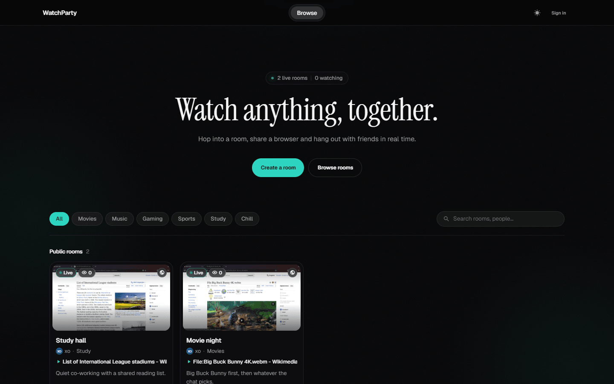
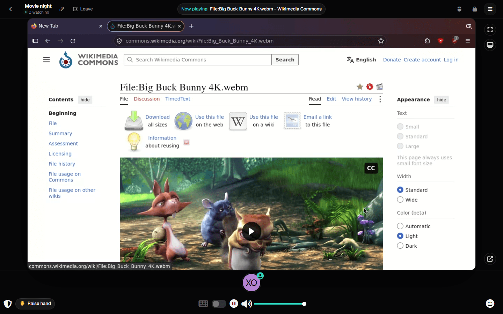
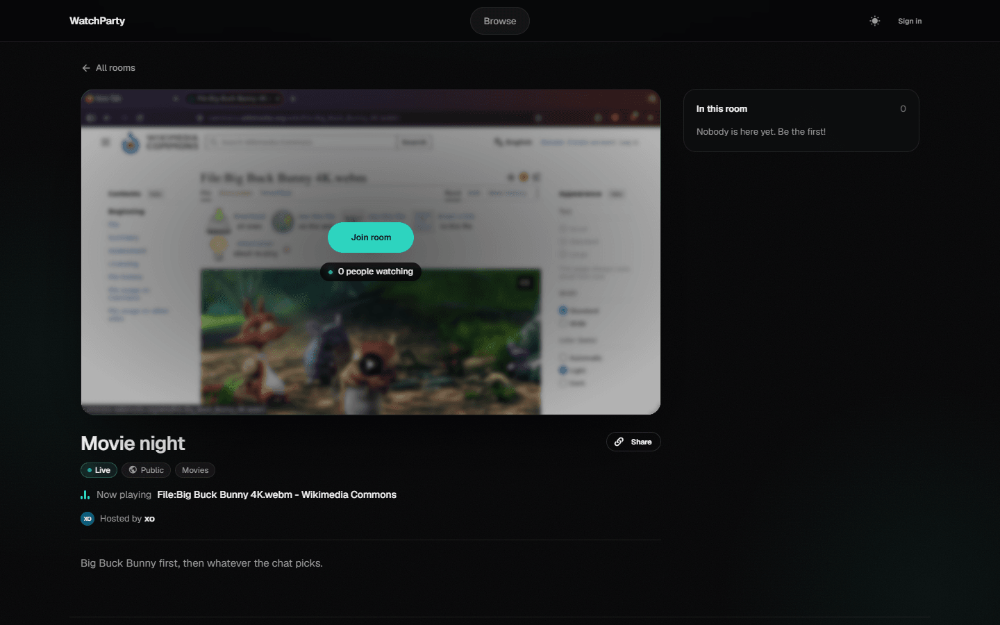
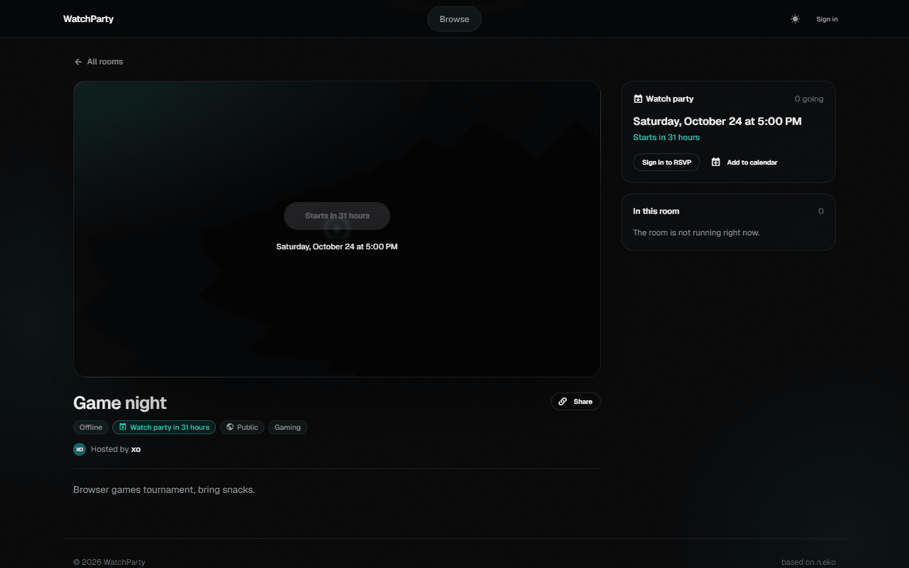
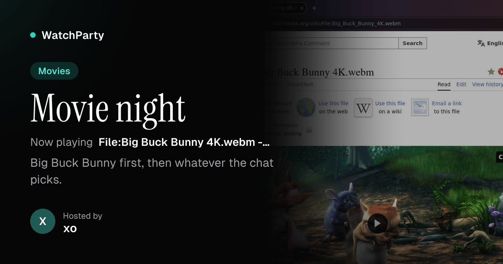
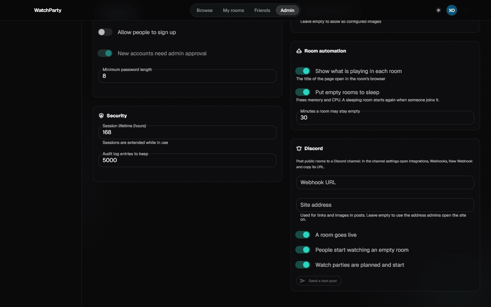
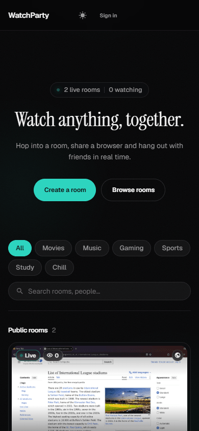

# neko-rooms · WatchParty edition

Self-hosted watch parties. Everyone in a room sees and hears the same browser, takes turns controlling it and chats on the side, from the web or the Android app.

This is a fork of [m1k1o/neko-rooms](https://github.com/m1k1o/neko-rooms), the room manager for [n.eko](https://github.com/m1k1o/neko). It adds a community homepage, accounts and friends, watch parties, link previews, Discord posts, an Android app and more ways to run it: one machine, a Raspberry Pi, a VPS, a remote docker host, Docker Swarm or Kubernetes.

<p align="center">
  
</p>

<table>
  <tr>
    <td width="50%"><br><sub><b>Inside a room</b>: what is playing at the top, raise your hand for control.</sub></td>
    <td width="50%"><br><sub><b>Room page</b>: live preview, who is in, share link.</sub></td>
  </tr>
  <tr>
    <td><br><sub><b>Watch parties</b>: RSVP, add to calendar, the room starts on its own.</sub></td>
    <td><br><sub><b>Link previews</b>: shared links show the room in Discord and other apps.</sub></td>
  </tr>
  <tr>
    <td><br><sub><b>Admin</b>: sleeping rooms, now playing, Discord posts and more.</sub></td>
    <td align="center"><br><sub><b>On a phone</b>, and there is an Android app.</sub></td>
  </tr>
</table>

## What it does

**Watching together**
- Shared browser rooms on [n.eko](https://github.com/m1k1o/neko): video and sound for everyone, one person in control at a time, chat.
- **Now playing**: room cards, previews and Discord posts show the page open in the room.
- **Raise hand** to get control next, the person in control hands it over with a click.
- Reactions with neko's emotes, shared with the Android app.
- **Watch parties**: give a room a start time, people RSVP and add it to their calendar, the homepage lists what is coming up, the room starts two minutes early.

**Community**
- A homepage with live rooms, categories and search, rooms that are public, for friends or invite only.
- Accounts with profile photos, friends, roles; an admin panel with branding and theme, policies and an audit log.
- Share links (`yoursite/r/room`) with previews of the room, its host and what is on.
- **Discord**: posts to a channel when public rooms go live, people start watching or a party is planned.

**Running it**
- **Sleep when empty**: rooms nobody is in stop after 30 minutes and wake up when someone joins.
- **Room templates**: YouTube, Twitch, music or movie night rooms with a start page, and ad blocking when storage is on.
- **Update button**: pulls the newest image of a room and recreates it with the same settings. Images that are not there yet are pulled when a room needs them.
- **API tokens** for scripts (`Authorization: Bearer ...`), see [docs/api.md](docs/api.md).
- **Anywhere**: locally over Tailscale, a Raspberry Pi, a VPS with or without a domain, a remote docker host over TCP or SSH, Docker Swarm, Kubernetes.

## Get started

### On your computer, shared over Tailscale

```bash
git clone https://github.com/xo907/neko-rooms.git && cd neko-rooms
./local/up.sh        # Windows: .\local\up.ps1
```

Builds this checkout and starts it on `http://localhost:8188`, then prints the addresses for your tailnet. No domain needed. [More](docs/local.md)

### On a VPS

Open to everyone on the server's public IP:

```bash
git clone https://github.com/xo907/neko-rooms.git && cd neko-rooms && ./local/up.sh --public
```

With [Nginx Proxy Manager](https://nginxproxymanager.com) for a domain and HTTPS, use `--npm` instead; it prints what to enter in the NPM web UI. Run the same command again later to update. [VPS](docs/local.md#vps-public-ip) · [NPM](docs/local.md#nginx-proxy-manager-domain--https)

### On a Raspberry Pi

Pi 4 or 5 with a 64-bit Raspberry Pi OS or Debian:

```bash
curl -fsSL https://raw.githubusercontent.com/xo907/neko-rooms/master/local/pi-install.sh | bash
```

Installs Docker and Tailscale when needed and starts a lighter Pi profile. [More](docs/local.md#raspberry-pi)

### Remote docker, Swarm, Kubernetes

```bash
kubectl apply -f deploy/k8s/neko-rooms.yaml
```

Rooms can run on another docker host (`NEKO_ROOMS_DOCKER_HOST=ssh://user@host` or `tcp://`), as Swarm services (`NEKO_ROOMS_RUNTIME=swarm`) or as Kubernetes pods (`NEKO_ROOMS_RUNTIME=k8s`). [How](docs/runtimes.md)

### Docker image

```bash
docker pull ghcr.io/xo907/neko-rooms:latest
```

The classic setups with Traefik from upstream still work: [traefik/](traefik/), [docker-compose.yml](docker-compose.yml).

## Android app

**WatchParty** is a native app for any neko-rooms server: browse and join rooms, watch with chat, take control with touch, mouse or keyboard, raise your hand, react, RSVP to parties, manage your account and friends.

Download `WatchParty.apk` from the [latest release](https://github.com/xo907/neko-rooms/releases?q=android-v&expanded=true) on your phone, open it to install and enter your server's address. Source in [android/](android/).

## Settings

The most used ones; everything else is in `neko_rooms serve --help` and the admin panel.

| Variable | |
|---|---|
| `NEKO_ROOMS_NAT1TO1` | public address of the machine rooms run on, viewers get video from there |
| `NEKO_ROOMS_EPR` | UDP/TCP ports rooms use for video, e.g. `59000-59049` |
| `NEKO_ROOMS_MUX` | one port per room instead of one per viewer, `true` is the easy choice |
| `NEKO_ROOMS_NEKO_IMAGES` | the browsers and apps rooms may use |
| `NEKO_ROOMS_ADMIN_USERNAME`, `_PASSWORD` | first admin account; no password prints a setup token in the log |
| `NEKO_ROOMS_RUNTIME` | `docker` (default), `swarm` or `k8s` |
| `NEKO_ROOMS_DOCKER_HOST` | another docker engine, `tcp://` or `ssh://` |
| `NEKO_ROOMS_STORAGE_ENABLED` | persistent room data, browser policies and extensions ([storage](docs/storage.md)) |

Room automation (sleeping rooms, now playing) and Discord are set in **Admin → Settings**, branding and theme in **Admin → Branding** ([admin panel](docs/admin-panel.md)).

## Updating

Run the install command again (`./local/up.sh`, `--public`, `--npm` or the Pi script), it pulls the new version and keeps your data. Room images are updated per room with the **Update** button in **My rooms** or on the room page.

## Credits

Built on [n.eko](https://github.com/m1k1o/neko) and [neko-rooms](https://github.com/m1k1o/neko-rooms) by [m1k1o](https://github.com/m1k1o) and contributors. Apache License 2.0.
